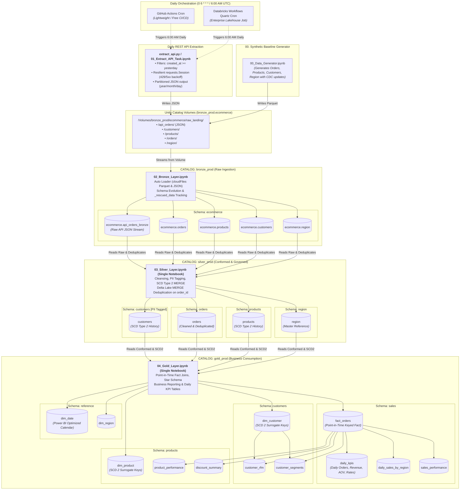

# Enterprise E-Commerce Lakehouse: Medallion Architecture on Databricks Unity Catalog

[](https://databricks.com)
[](https://delta.io)
[](https://docs.databricks.com/data-governance/unity-catalog/index.html)
[-4285F4)](https://docs.databricks.com/ingestion/auto-loader/index.html)
[](https://powerbi.microsoft.com)
[](LICENSE)

An enterprise-grade, production-ready **Medallion Architecture (Bronze $\rightarrow$ Silver $\rightarrow$ Gold)** data pipeline built on **Azure Databricks** with **Unity Catalog 3-Level Namespace** (`<catalog>.<schema>.<table>`) featuring **Multi-Environment Isolation (`dev` $\rightarrow$ `prod`)** and zero-copy Delta cloning. 

This project demonstrates advanced data engineering practices including **Auto Loader streaming ingestion**, **SCD Type 2 (Slowly Changing Dimensions) with Delta Lake MERGE**, **point-in-time fact table joins**, **PII governance tags**, and a **Power BI-optimized dimensional model**.

---

## Architecture Diagram



---


---

## Multi-Environment Architecture & Dev $\rightarrow$ Prod Promotion Strategy

The entire platform is engineered around **strict environment isolation** with zero code divergence between development and production.

```
┌──────────────────────────────────────────────┐          ┌──────────────────────────────────────────────┐
│        DEVELOPMENT (target_env = 'dev')      │          │       PRODUCTION (target_env = 'prod')       │
├──────────────────────────────────────────────┤          ├──────────────────────────────────────────────┤
│ • Catalogs: bronze_dev, silver_dev, gold_dev │  PROACT  │ • Catalogs: bronze_prod, silver_prod, ...    │
│ • Volume:   /Volumes/bronze_dev/...          │  SHALLOW │ • Volume:   /Volumes/bronze_prod/...         │
│ • Checkpoint: /Volumes/bronze_dev/checkpoints│  CLONE   │ • Checkpoint: /Volumes/bronze_prod/...       │
│ • Schedule:  On-Demand / Interactive Testing │ ◄─────── │ • Schedule: Daily 6:00 AM UTC (0 0 6 * * ?)  │
└──────────────────────┬───────────────────────┘          └──────────────────────▲───────────────────────┘
                       │                                                         │
                       └─────────────────── PROMOTED PIPELINE ───────────────────┘
                                   (Runs with target_env = 'prod')
```

### 1. Unified Codebase with Parameterized Namespace
No code is duplicated between environments. All notebooks and scripts dynamically resolve their catalogs, landing paths, and streaming checkpoints using `target_env` from `01_Config`:
- **Development**: `bronze_dev`, `silver_dev`, `gold_dev`
- **Production**: `bronze_prod`, `silver_prod`, `gold_prod`
- **Landing Volumes**: `/Volumes/bronze_{env}/ecommerce/raw_landing/`
- **Checkpoints**: `/Volumes/bronze_{env}/ecommerce/checkpoints/` (Streaming checkpoints are isolated so Dev tests never corrupt or lock production state).

### 2. Zero-Copy Shallow Clone (`clone_prod_to_dev`)
When testing schema changes or business transformations in Dev, developers can instant-snapshot realistic production tables using native Delta Lake **zero-copy shallow cloning**:
```python
# In 01_Config or Run_Pipeline (target_env = "dev")
clone_prod_to_dev(source_env="prod", target_env="dev")
```
This references production metadata without copying underlying parquet data, allowing realistic tests with zero additional storage costs.

### 3. Promotion Lifecycle
1. **Develop & Test in Dev**: Run `Run_Pipeline.ipynb` with `target_env = "dev"`.
2. **Verify Assertions & KPIs**: Confirm data quality and inspect KPI aggregations in `gold_dev.sales.daily_kpis`.
3. **Promote via Workflow**: Run `databricks_workflow.json` with job parameter `target_env = "prod"`.

## Unity Catalog 3-Level Namespace Structure (`<catalog>.<schema>.<table>`)

| Catalog | Schema | Object Type | Objects / Tables | Description & Governance |
|:---|:---|:---:|:---|:---|
| **`bronze_prod`** | `ecommerce` | Volume<br/>Volume<br/>Delta Table<br/>Delta Table<br/>Delta Table<br/>Delta Table | `raw_landing`<br/>`checkpoints`<br/>`orders`<br/>`products`<br/>`customers`<br/>`region` | Raw source landing zone and streaming checkpoints. Ingested via Auto Loader, tracking malformed/corrupted rows in `_rescued_data`. |
| **`silver_prod`** | `customers`<br/><br/>`orders`<br/><br/>`products`<br/><br/>`region` | Delta Table<br/><br/>Delta Table<br/><br/>Delta Table<br/><br/>Delta Table | `customers`<br/><br/>`orders`<br/><br/>`products`<br/><br/>`region` | **SCD Type 2** tracking with SHA-256 change detection. PII tagged (`classification = 'PII'`).<br/>Cleaned transactions, timestamp casting, window rankings.<br/>**SCD Type 2** tracking for price and attribute history.<br/>Standardized corporate geographic master data. |
| **`gold_prod`** | `sales`<br/><br/><br/>`customers`<br/><br/><br/>`products`<br/><br/><br/>`reference` | Delta Table<br/>Delta Table<br/>Delta Table<br/>Delta Table<br/>Delta Table<br/>Delta Table<br/>Delta Table<br/>Delta Table<br/>Delta Table<br/>Delta Table<br/>Delta Table | `fact_orders`<br/>`daily_sales_by_region`<br/>`sales_performance`<br/>`dim_customer`<br/>`customer_rfm`<br/>`customer_segments`<br/>`dim_product`<br/>`product_performance`<br/>`discount_summary`<br/>`dim_date`<br/>`dim_region` | **Point-in-Time Fact Table** with financial metrics.<br/>Daily revenue & AOV by geography.<br/>Quarterly sales trends by category.<br/>SCD Type 2 Customer dimension with surrogate key.<br/>Customer RFM segmentation (Champions, Loyal, At Risk).<br/>Customer segment aggregation.<br/>SCD Type 2 Product dimension with surrogate key.<br/>Product volume, revenue, and return analytics.<br/>Discounting and margin performance.<br/>**Power BI-ready continuous calendar (2020-2030)**.<br/>Geographic dimension with `region_sk`. |

---

## Key Engineering Highlights

### 1. Auto Loader (`cloudFiles`) Ingestion
- Streams raw Parquet files from Unity Catalog volumes into managed Delta tables using `.trigger(availableNow=True)`.
- Persists state in dedicated checkpoint volume locations.
- Safely captures corrupt or evolving schema fields in `_rescued_data` without failing production pipelines.

### 2. SCD Type 2 with Delta Lake MERGE
For mutable dimensions (`customers` and `products`), changes are tracked historically:
- **`record_hash`**: SHA-256 hash across business attributes to instantly detect changes.
- **`valid_from` & `valid_to`**: Effective date range for point-in-time validity.
- **`is_current`**: Boolean indicator (`true` for active record, `false` for historical).
- Implements the canonical 2-pass Delta Lake MERGE pattern:
  1. Expire existing active version where hash changed (`is_current = false, valid_to = current_timestamp()`).
  2. Insert new version (`is_current = true, valid_from = current_timestamp(), valid_to = NULL`).

### 3. Point-in-Time Fact Table Joins
In `gold_prod.sales.fact_orders`, order transactions join to customer and product dimensions using **point-in-time joins**:
```sql
SELECT
    o.order_id,
    c.customer_sk,
    p.product_sk,
    r.region_sk,
    d.date_key as order_date_key,
    o.quantity,
    o.unit_price,
    o.total_amount,
    o.discount_amount,
    o.net_amount
FROM silver_prod.orders.orders o
LEFT JOIN gold_prod.customers.dim_customer c
    ON o.customer_id = c.customer_id
    AND o.order_date >= c.valid_from
    AND (c.valid_to IS NULL OR o.order_date < c.valid_to)
LEFT JOIN gold_prod.products.dim_product p
    ON o.product_id = p.product_id
    AND o.order_date >= p.valid_from
    AND (p.valid_to IS NULL OR o.order_date < p.valid_to)
LEFT JOIN gold_prod.reference.dim_region r
    ON o.region_id = r.region_id
LEFT JOIN gold_prod.reference.dim_date d
    ON to_date(o.order_date) = d.full_date
```
Historical orders remain accurately tied to the customer address and product pricing that was active at the moment of purchase.

### 4. Power BI-Optimized Reusable Date Table (`gold_prod.reference.dim_date`)
A continuous calendar from **2020-01-01 to 2030-12-31** (4,018 days) engineered for Power BI:
- **`date_key`**: Integer surrogate key (`YYYYMMDD`, e.g. `20240115`) for 1-to-many relationship join to `fact_orders.order_date_key`.
- **`full_date`**: Native `Date` column for **"Mark as Date Table"** in Power BI (unlocks DAX `TOTALYTD`, `SAMEPERIODLASTYEAR`, `DATESINPERIOD`).
- **`year_month_sort`**: Integer `YYYYMM` (e.g. `202401`) designed for **"Sort by Column"** in Power BI, preventing alphabetical month sorting.
- Includes ISO Weeks, Fiscal Calendar (July-June), and Weekend/Weekday flags.

### 5. Unity Catalog Governance & PII Protection
- Customer data containing PII (names, emails, phone numbers) is quarantined in `silver_prod.customers`.
- Programmatically tagged:
  ```sql
  ALTER TABLE silver_prod.customers.customers SET TAGS ('classification' = 'PII', 'sensitivity' = 'Restricted');
  ```
- Downstream Gold tables provide anonymized aggregates and sanitized analytical models for general business consumption.

---

## Repository Structure

```
├── .github/
│   └── workflows/
│       └── daily_extract.yml   # GitHub Actions daily cron (0 6 * * *) workflow
├── 00_Data_Generator.ipynb     # Standalone synthetic source data generator (CDC & SCD2 testing)
├── 01_Config.ipynb             # Centralized catalog, schema, volume setup & init_environment()
├── 01_Extract_API_Task.ipynb   # Databricks workflow task for previous-day REST API extraction
├── 02_Bronze_Layer.ipynb       # Auto Loader streaming ingestion (Parquet & JSON)
├── 03_Silver_Layer.ipynb       # Single Silver notebook (Cleansing, PII, SCD Type 2 & Deduplication)
├── 04_Gold_Layer.ipynb         # Single Gold notebook (Star Schema, Power BI Date Table & Daily KPIs)
├── Run_Pipeline.ipynb          # End-to-end master pipeline orchestrator
├── extract_api.py              # Standalone resilient Python REST API extractor (requests + retries)
├── requirements.txt            # Python dependencies (requests, python-dateutil, python-dotenv)
├── tests/
│   └── test_extract.py         # Unit tests for date windowing, mock generator, and NDJSON writing
├── databricks_workflow.json    # Production multi-task Databricks Workflow job definition with cron
├── README.md                   # Complete architectural documentation & portfolio guide
└── .gitignore                  # Standard Databricks / Python ignore rules
```

---

## Quickstart Guide

### Option 1: Run via Databricks Notebooks (Manual)
1. **Clone this repository** into your Databricks Workspace under **Repos / Git Folders**.
2. Open **`Run_Pipeline.ipynb`**.
3. Keep default widget parameters (`generate_sample_data = "true"`, `batch_mode = "initial"`).
4. Click **Run All**.
   - `01_Config` initializes `bronze_prod`, `silver_prod`, and `gold_prod` catalogs, schemas, and volumes.
   - `00_Data_Generator` generates 5,000 customers, 200 products, 25,000 orders, and 8 regions into `/Volumes/bronze_prod/ecommerce/raw_landing/`.
   - `02_Bronze_Layer` streams raw data into Bronze managed tables.
   - `03_Silver_Layer` conforms domains and initializes SCD Type 2 active records.
   - `04_Gold_Layer` builds the Power BI date table, fact orders, and business reporting marts.

### Option 2: Test SCD Type 2 Updates
1. Run **`Run_Pipeline.ipynb`** with widget `batch_mode = "update"`.
2. The generator will simulate updates to 150 customer profiles and 25 product prices.
3. Observe `03_Silver_Layer` automatically closing out the superseded versions (`is_current = false, valid_to = current_timestamp()`) and inserting the new active versions (`is_current = true, valid_to = NULL`).

### Option 3: Deploy via Databricks Workflows (Automated Job)
1. In the Databricks UI, navigate to **Workflows $\rightarrow$ Jobs**.
2. Click **Create Job $\rightarrow$ Import from JSON** (or use the Databricks CLI):
   ```bash
   databricks jobs create --json-file databricks_workflow.json
   ```
3. Run the automated multi-task DAG pipeline scheduled daily at 06:00 UTC (`0 0 6 * * ?`).

### Option 4: Run Daily Python REST API Extractor (CLI or CI/CD)
1. **Local CLI Execution**:
   ```bash
   pip install -r requirements.txt
   python extract_api.py --date yesterday --output-dir ./landing_data/api_orders
   ```
2. **GitHub Actions (Automated Daily 6:00 AM UTC)**:
   - Configured in `.github/workflows/daily_extract.yml`.
   - Runs automatically on cron `0 6 * * *` or via manual **Run workflow** in the GitHub Actions tab.
   - Saves extracted JSON as 90-day build artifacts and optionally pushes directly to Databricks Volume when secrets `DATABRICKS_HOST` and `DATABRICKS_TOKEN` are provided.

---

## Power BI Integration Guide

```
┌─────────────────────────────────┐           ┌─────────────────────────────────┐
│   gold_prod.reference.dim_date  │           │ gold_prod.customers.dim_customer│
│   (1)                           │           │ (1)                             │
└────────────────┬────────────────┘           └────────────────┬────────────────┘
                 │ date_key                                    │ customer_sk
                 │ (1-to-Many)                                 │ (1-to-Many)
                 ▼                                             ▼
        ┌──────────────────────────────────────────────────────────────┐
        │                 gold_prod.sales.fact_orders                  │
        │                 (*)                                          │
        └──────────────────────────────┬───────────────────────────────┘
                                       │ product_sk
                                       │ (Many-to-1)
                                       ▼
                        ┌─────────────────────────────────┐
                        │  gold_prod.products.dim_product │
                        │  (1)                            │
                        └─────────────────────────────────┘
```

1. **Connect to Databricks**: In Power BI Desktop, select **Get Data $\rightarrow$ Azure Databricks** and enter your Server Hostname and HTTP Path.
2. **Select Gold Tables**:
   - `gold_prod.sales.fact_orders`
   - `gold_prod.reference.dim_date`
   - `gold_prod.customers.dim_customer`
   - `gold_prod.products.dim_product`
   - `gold_prod.reference.dim_region`
3. **Configure Relationships**:
   - `fact_orders[order_date_key]` $\rightarrow$ `dim_date[date_key]` (Single, 1-to-Many)
   - `fact_orders[customer_sk]` $\rightarrow$ `dim_customer[customer_sk]` (Single, 1-to-Many)
   - `fact_orders[product_sk]` $\rightarrow$ `dim_product[product_sk]` (Single, 1-to-Many)
   - `fact_orders[region_sk]` $\rightarrow$ `dim_region[region_sk]` (Single, 1-to-Many)
4. **Mark as Date Table**: Right-click `dim_date` $\rightarrow$ **Mark as Date Table** $\rightarrow$ select `full_date`.
5. **Set Month Sorting**: Select column `dim_date[month_name]` $\rightarrow$ click **Sort by Column** in the ribbon $\rightarrow$ select `year_month_sort`.

---

## Sample Analytical Queries

### 1. Point-in-Time Customer Revenue Evolution
```sql
SELECT
    c.customer_id,
    c.fullname,
    c.email,
    c.valid_from,
    c.valid_to,
    c.is_current,
    COUNT(f.order_id) as total_orders,
    ROUND(SUM(f.net_amount), 2) as total_spent
FROM gold_prod.customers.dim_customer c
JOIN gold_prod.sales.fact_orders f
    ON c.customer_sk = f.customer_sk
GROUP BY 1, 2, 3, 4, 5, 6
ORDER BY total_spent DESC
LIMIT 10;
```

### 2. Year-over-Year Revenue by Regional Market
```sql
SELECT
    d.year,
    r.region_name,
    COUNT(f.order_id) as total_orders,
    ROUND(SUM(f.net_amount), 2) as net_revenue,
    ROUND(AVG(f.net_amount), 2) as aov
FROM gold_prod.sales.fact_orders f
JOIN gold_prod.reference.dim_date d ON f.order_date_key = d.date_key
JOIN gold_prod.reference.dim_region r ON f.region_sk = r.region_sk
WHERE f.order_status = 'COMPLETED'
GROUP BY d.year, r.region_name
ORDER BY d.year DESC, net_revenue DESC;
```

### 3. Customer RFM Distribution
```sql
SELECT
    rfm_segment,
    COUNT(customer_id) as customer_count,
    ROUND(AVG(recency_days), 1) as avg_recency_days,
    ROUND(AVG(frequency), 1) as avg_orders,
    ROUND(SUM(monetary_value), 2) as total_revenue
FROM gold_prod.customers.customer_rfm
GROUP BY rfm_segment
ORDER BY total_revenue DESC;
```

---

## License

This project is licensed under the MIT License — see the [LICENSE](LICENSE) file for details.
